<div align="center">



</div>





**ILMS** is an Integrated Library Management System: a web app where members browse a book catalog, borrow and return books, and join a reservation queue when every copy is out. Library staff manage members, books, loans and reservations from their own dashboards.

It is a **Flask** application backed by a single **SQLite** file, with a **Vite** frontend that talks to a small JSON API. Seeding, roles and fines are built in, so a fresh clone runs with no extra setup.




<details>
<summary><b>✦ Full feature list</b></summary>

<br/>

| Area | What it does |
| :--- | :--- |
| 📚 **Catalog** | Browse all books, open a detail page with related titles. An empty database is seeded with 100 demo books. |
| 🔎 **Search** | Search by title, author, category or ISBN through `/api/books?q=`. |
| 🔁 **Loans** | Issue a book for **7 days**. Each member can hold one active copy of a given title. Returns restock the copy. |
| ⏳ **Reservations** | When no copies are left, members queue up. On a return, the next people in line are marked **Notified** and a copy is held for them. |
| 💸 **Fines** | **INR 5 per overdue day**, shown to members and totalled for staff. |
| 🔐 **Roles** | Member, librarian and admin accounts with separate dashboards. |
| 🧰 **Staff tools** | Add books, issue and reserve on behalf of members, remove active issues and reservations (admin). |
| 🌐 **API + CORS** | JSON endpoints with cookie sessions and an allow-list of frontend origins. |

</details>




| Role | Can do |
| :--- | :--- |
| 👤 **Member** | Register, log in, browse and search books, issue and return books, reserve unavailable titles, view their dashboard with fines and due dates |
| 🧑‍💼 **Librarian** | Everything on the staff desk: view members, books, issues and reservations, add books, issue and reserve for members (dashboard at `/librarian`) |
| 🛡️ **Admin** | Everything a librarian can, plus the admin dashboard at `/admin`, adding books from the form, and removing active issues or reservations |












```bash
git clone https://github.com/SyedRaqi/ILMS.git
cd ILMS && pip install -r requirements.txt
flask --app app run
pytest
```

Open <http://127.0.0.1:5000>. The database file `library.db` is created next to `app.py` on first run and seeded with demo books.

<details>
<summary><b>✦ Use a virtual environment</b></summary>

```bash
python -m venv .venv
source .venv/bin/activate        # Windows: .venv\Scripts\activate
pip install -r requirements.txt
```

</details>

<details>
<summary><b>✦ Run the Vite frontend</b></summary>

The API allows the Vite dev origins `http://localhost:5173` and `http://127.0.0.1:5173` out of the box.

```bash
cd frontend
npm install
npm run dev
```

</details>


All settings are environment variables. Nothing is required for local development.

| Variable | Purpose |
| :--- | :--- |
| `SECRET_KEY` | Signs login sessions. **Set a long random value in production.** A development fallback is used otherwise. |
| `DATABASE_PATH` | Where the SQLite file lives. On Render, use a persistent disk, for example `/var/data/library.db`. |
| `FRONTEND_ORIGIN` | Comma-separated browser origins allowed to call the API, for example your GitHub Pages URL. |
| `ILMS_ADMIN_PASSWORD` | If set, creates the admin account `admin@ilms.edu` on startup. |
| `ILMS_LIBRARIAN_PASSWORD` | If set, creates the librarian account `librarian@ilms.edu` on startup. |

> 🔒 Staff accounts are created **only** when their password variable is set, so there are no publicly known default passwords. Startup never deletes existing books.

**Deploy:** run the app with `gunicorn app:app` (Gunicorn is in `requirements.txt`).


| Method | Endpoint | Access | Description |
| :-: | :--- | :--- | :--- |
| `GET` | `/api/books?q=&limit=` | Public | List or search books (limit 1 to 100) |
| `GET` | `/api/admin/overview` | Staff | Members, books, issues, reservations and totals |
| `POST` | `/api/admin/books` | Staff | Add a book (`title`, `author`, `category`, `isbn`, optional `copies`, `cover`, `description`) |
| `POST` | `/api/admin/issue` | Staff | Issue a book (`member_id`, `book_id`) |
| `POST` | `/api/admin/reserve` | Staff | Reserve an unavailable book (`member_id`, `book_id`) |

<details>
<summary><b>✦ Web pages</b></summary>

<br/>

| Area | Routes |
| :--- | :--- |
| Public | `/`, `/books`, `/book/<id>`, `/login`, `/register` |
| Member | `/dashboard`, plus issue, return and reserve actions |
| Staff | `/librarian` |
| Admin | `/admin`, `/admin/options` |

</details>

<details>
<summary><b>✦ Project structure</b></summary>

```text
ILMS/
├── app.py              # Flask app: routes, API, SQLite schema and seeding
├── requirements.txt    # Flask, Gunicorn, Pytest
├── frontend/           # Vite frontend
├── templates/          # Server-rendered pages
├── static/             # CSS, JS and images
├── tests/              # Pytest suite
├── library.db          # SQLite database (created on first run)
└── LICENSE             # Unlicense
```

</details>


